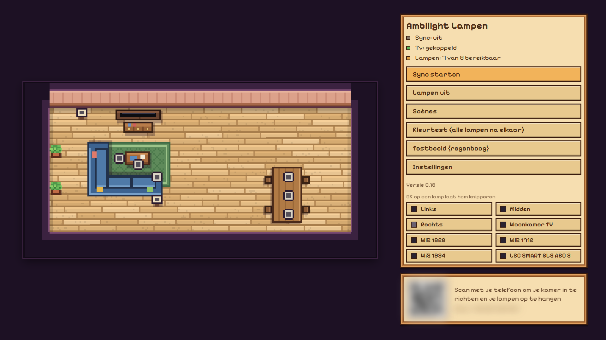
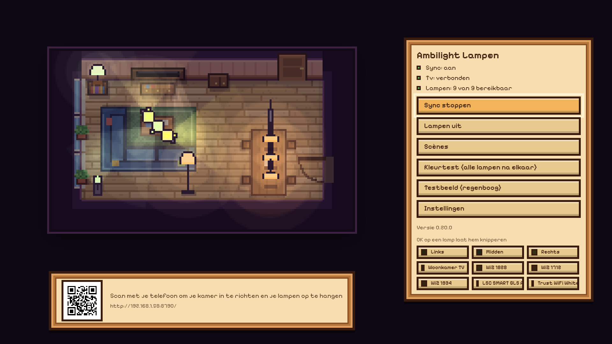

# Ambilight Lamps

[Nederlands](README.md) | English

Android TV app that makes ordinary Tuya Wi-Fi lamps (Trust, LSC/Action and other brands that work with Smart Life) follow the picture of a Philips Ambilight TV, a bit like Philips Hue Sync. The app runs on the TV itself, so no PC or extra box needs to be on.




## What it does

- **Follow the picture:** the TV measures the colours along the edges of the picture itself (Ambilight). The app reads them about 15 times per second and sends every lamp the colour of the part of the picture that matches its place in the room. This works with everything on the TV, including Netflix, Disney+ and HDMI devices.
- **Draw your room:** the TV shows a QR code. Scan it with your phone to get an editor in pixel-art style: lay floor per 1-metre square (8 floor types), place furniture (sofa, corner sofa, armchair, coffee table, dining table, plant, rug, cabinet, bed; rotate, mirror, resize), place the TV and your lamps (ceiling, table or floor; spot or rod lamp).
- **Position decides colour:** a lamp to the left of the TV follows the left side of the picture, a ceiling lamp in front of the TV follows the part of the top edge above it, a rod lamp follows its side from bottom to top. The further a lamp is from the TV, the wider it looks.
- **Test and tune:** blink or test each lamp, pick a colour, a rotating rainbow test pattern with your room in view (move lamps with the remote), and settings on the TV and on your phone.
- **Updates:** the app checks GitHub for new releases and shows what's new before updating.
- **Languages:** Dutch and English (Settings, Language).

## Install

Enable Developer options, USB debugging and Network debugging on the TV and install the APK from the [releases](https://github.com/ingesluis1/AmbilightLampen/releases), or build it yourself:

```
set JAVA_HOME=C:\Program Files\Android\Android Studio\jbr
gradlew assembleDebug
adb connect <tv-ip>:5555
adb install -r app\build\outputs\apk\debug\app-debug.apk
```

## First setup

1. Open the app on the TV and scan the QR code with your phone (same Wi-Fi).
2. **Pair the TV:** press "Pair TV". A PIN code appears on the TV; enter it on your phone.
3. **Add lamps:** create a cloud project on [iot.tuya.com](https://iot.tuya.com) (Smart Home, the data center that matches your account) and link your Smart Life account via the QR code under Devices, Link App Account. Enter the project's Access ID and Access Secret in the editor and press "Save and search". New lamp later? Pair it in Smart Life and press "Find new lamps".
   Without cloud keys in the app: upload the `devices.json` from the [tinytuya](https://github.com/jasonacox/tinytuya) wizard instead.
4. Draw your room, place the lamps and press "Start sync".

## Privacy

Lamp keys, TV pairing and Tuya keys are only stored in the app storage on the TV. The phone page never gets them back. Lamps are controlled locally over Wi-Fi; the Tuya cloud is only used to fetch names and keys of new lamps.

## Limitations

- Tuya local protocol 3.1, 3.3, 3.4 and 3.5.
- Only Philips TVs with Ambilight and the JointSpace API (version 6, Android TV). Tested on a 65OLED810.
- Tuya's free IoT Core plan expires after a month (it can be extended). After that only "Find new lamps" stops working.
- Wi-Fi lamps are slower than Hue Entertainment: expect 0.1 to 0.3 seconds of delay.
