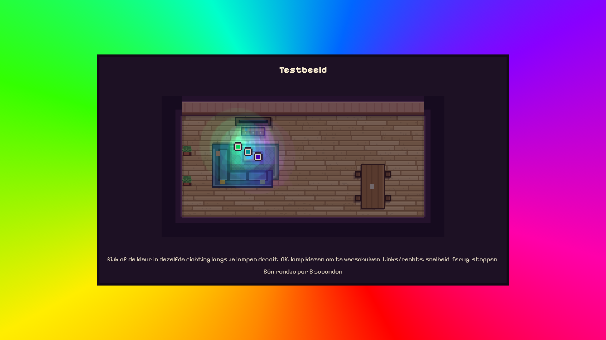
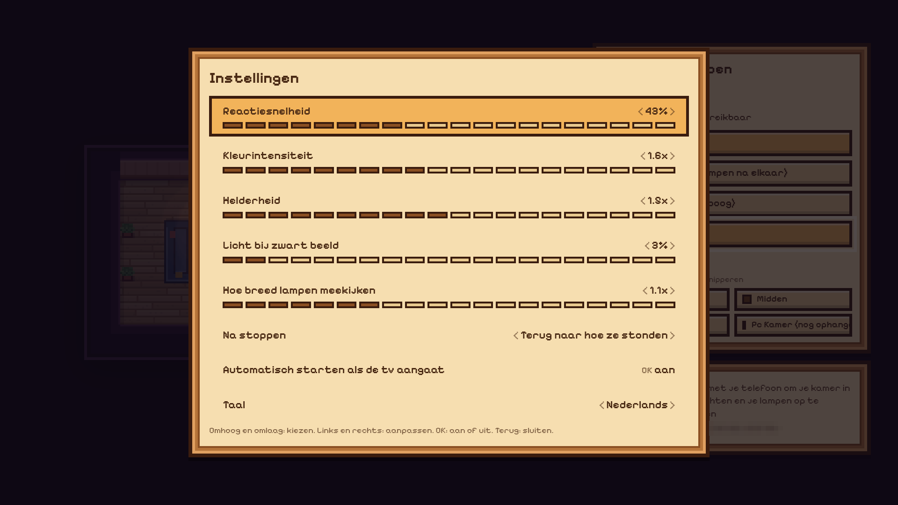
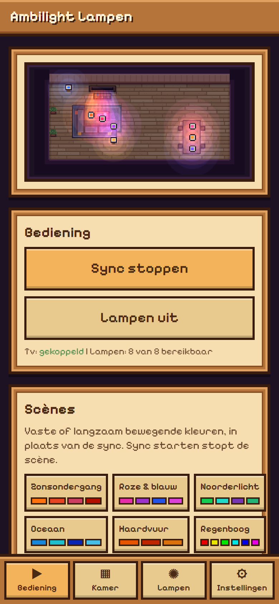
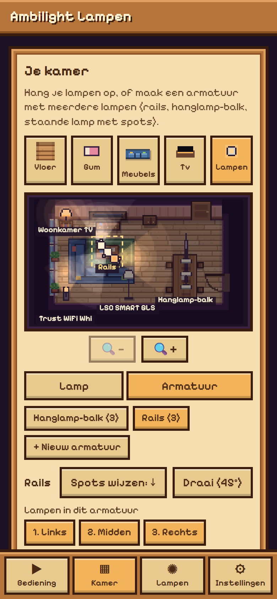
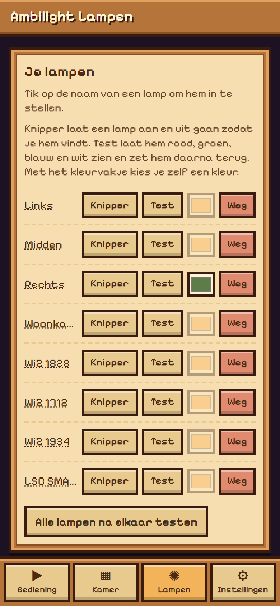
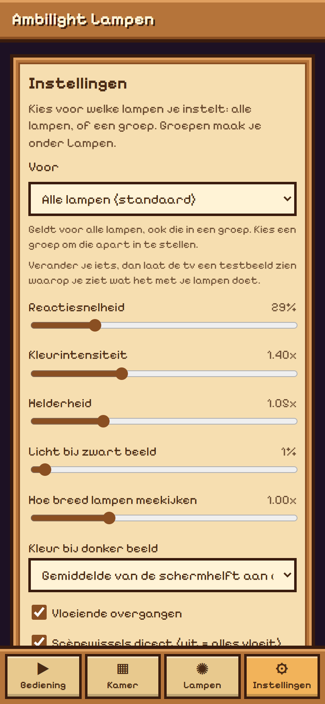

# Ambilight Lampen

Nederlands | [English](README.en.md)

Android TV-app die gewone Tuya-wifilampen (Trust, LSC/Action en andere merken die in Smart Life werken), WiZ-lampen, Philips Hue-lampen en IKEA-lampen (via de DIRIGERA) laat meekleuren met het beeld van een Philips Ambilight-tv, een beetje zoals Philips Hue Sync. De app draait op de tv zelf, dus er hoeft geen pc of extra kastje aan te staan.

<p>
  
  
  
  
</p>
<p>
  
  
  
  
</p>

## Wat de app doet

- **Meekleuren:** de tv meet zelf de kleuren aan de randen van het beeld (Ambilight). De app leest die ongeveer 15 keer per seconde uit en stuurt elke lamp de kleur van het stuk beeld dat bij zijn plek in de kamer hoort. Dat werkt bij alles wat op de tv speelt, ook Netflix, Disney+ en HDMI-apparaten.
- **Je kamer tekenen:** op het tv-scherm staat een QR-code. Scan die met je telefoon en je krijgt een editor in pixel-art-stijl: vloer leggen per vakje van 1 meter (8 vloersoorten), meubels neerzetten (bank, hoekbank, fauteuil, salontafel, eettafel, plant, kleed, kast, bed; draaien, spiegelen, maat aanpassen), de tv plaatsen en je lampen ophangen (plafond, tafel of vloer).
- **Plek bepaalt kleur:** een lamp links van de tv volgt de linkerkant van het beeld, een plafondlamp recht voor de tv het stuk bovenrand erboven. Hoe verder een lamp van de tv hangt, hoe breder hij meekijkt.
- **Instellingen:** reactiesnelheid, kleurintensiteit, helderheid, licht bij zwart beeld, blikveld van de lampen, wat de lampen na afloop doen (terug naar hoe ze stonden, warm wit of uit) en automatisch starten als de tv aangaat.
- **Per lamp instelbaar:** wat hij volgt (automatisch op plek, bovenrand, hele zijkant of hele beeld), hoogte (plafond, vensterbank, tafel, vloer), en bij lampen met meerdere kleurlagen (zoals een Eurodomest Wall Washer) elke laag apart.
- **Vloeiend en snel:** kleine veranderingen vloeien over, scènewissels gaan direct; donkere scènes worden echt donker. Elke lamp krijgt het tempo dat hij aankan.
- **Tv uit:** na 20 seconden zwart beeld gaan de lampen terug naar hun gewone stand.
- **Talen:** Nederlands en Engels (Instellingen, Taal).
- **Standby:** gaat het scherm uit, dan stopt de sync en gaan de lampen terug naar hun oude stand. Bij aanzetten gaat hij weer verder.

## Installeren

Zet op de tv Ontwikkelaarsopties, USB-foutopsporing en Netwerkfoutopsporing aan en installeer de APK:

```
set JAVA_HOME=C:\Program Files\Android\Android Studio\jbr
gradlew assembleDebug
adb connect <ip-van-de-tv>:5555
adb install -r app\build\outputs\apk\debug\app-debug.apk
```

## Eerste keer instellen

1. Open de app op de tv en scan de QR-code met je telefoon (zelfde wifi).
2. **Tv koppelen:** druk op "Koppel tv". Er verschijnt een pincode op de tv; vul die in op je telefoon.
3. **Lampen toevoegen:** maak op [iot.tuya.com](https://iot.tuya.com) een cloudproject (Smart Home, datacenter dat bij je account hoort, voor Nederland Central Europe) en koppel je Smart Life-account eraan via de QR-code onder Devices, Link App Account. Vul daarna in de editor de Access ID en het Access Secret van het project in en druk op "Opslaan en zoeken". Komt er later een lamp bij: koppel hem in Smart Life en druk op "Nieuwe lampen zoeken".
   Alternatief zonder cloud-sleutels in de app: upload het `devices.json` van de [tinytuya](https://github.com/jasonacox/tinytuya)-wizard.
   **WiZ:** zet in de WiZ-app bij Instellingen, Beveiliging "Lokale communicatie" aan en druk op "WiZ-lampen zoeken".
   **Philips Hue:** druk bij Philips Hue op "Koppelen" en daarna op de grote knop op de Bridge. Lampen van andere merken die aan de Bridge gekoppeld zijn (zoals IKEA) komen ook mee. Maak voor de snelste reactie in de Hue-app een Entertainment-ruimte met je Hue-lampen: die krijgen dan de Entertainment-stream, net als bij Hue Sync.
   **IKEA:** druk bij IKEA (DIRIGERA) op "Koppelen" en daarna op de actieknop onder op de hub.
4. Teken je kamer, hang de lampen op en druk op "Sync starten".

De ip-adressen van de lampen vindt de app zelf: Tuya-lampen roepen elke paar seconden hun adres om op het netwerk.

## Privacy

De local keys van de lampen, de tv-koppeling en de Tuya-sleutels staan alleen in de app-opslag op de tv (`config.json`). De telefoon-pagina krijgt ze nooit terug te zien. Het aansturen van de lampen gebeurt lokaal via het wifinetwerk; de Tuya-cloud wordt alleen gebruikt om namen en sleutels van nieuwe lampen op te halen.

## Beperkingen

- Lokaal Tuya-protocol 3.1, 3.3, 3.4 en 3.5 (Trust, LSC/Action en de meeste andere Smart Life-lampen).
- Alleen Philips-tv's met Ambilight en de JointSpace-API (versie 6, Android TV). Getest op een 65OLED810.
- Het gratis IoT Core-abonnement van Tuya loopt na een maand af (verlengen kan). Daarna werkt alleen "Nieuwe lampen zoeken" niet meer; lampen die al in de app staan blijven werken.
- Hue werkt alleen via een Hue Bridge. Zonder Entertainment-ruimte, en voor lampen van andere merken aan de Bridge, verwerkt de Bridge samen ongeveer 10 opdrachten per seconde: hoe meer van die lampen, hoe trager elk afzonderlijk.
- Wifilampen zijn trager dan Hue Entertainment: reken op 0,1 tot 0,3 seconde vertraging. Voor sfeer werkt dat goed, heel korte flitsen komen deels later.

## Hoe het in elkaar zit

| Bestand | Wat |
|---|---|
| `PhilipsTv.kt` | JointSpace-API op poort 1926: https, digest-login, koppelen met pincode, `ambilight/measured` uitlezen |
| `Tuya.kt` | Lokaal Tuya-protocol 3.3 (AES-ECB, frames met CRC32), een vaste verbinding per lamp, alleen de nieuwste kleur wordt verstuurd |
| `Discovery.kt` | Luistert op UDP 6666/6667 naar de omroep van de lampen en houdt ip-adressen bij |
| `TuyaCloud.kt` | Haalt namen en local keys op via de Tuya OpenAPI |
| `Engine.kt` | Projecteert elke lamp op het tv-vlak, weegt de randzones, maakt de kleur verzadigder en gladder en stuurt hem door |
| `WebServer.kt` | Mini-webserver voor de telefoon-editor en het tv-scherm, met een kleine JSON-API |
| `assets/room.js` | Tekenmotor in pixel-art-stijl (1 meter = 16 pixels), gedeeld door tv en telefoon |
| `assets/index.html`, `assets/tv.html` | Telefoon-editor en tv-scherm |

Het koppelen met de tv volgt hoe [pylips](https://github.com/eslavnov/pylips) en [ha-philipsjs](https://github.com/danielperna84/ha-philipsjs) het doen; het lampprotocol volgt [tinytuya](https://github.com/jasonacox/tinytuya).
