# Meubels op de plattegrond

In de meubelkiezer staan de meubels in groepen. De kiezer opent met de groep die bij de naam van de kamer past
("Keuken" toont de keukenmeubels). Alle meubels kun je draaien en groter of kleiner maken.

## Voorbeeldkamers

| Keuken | Slaapkamer | PC kamer |
|---|---|---|
| 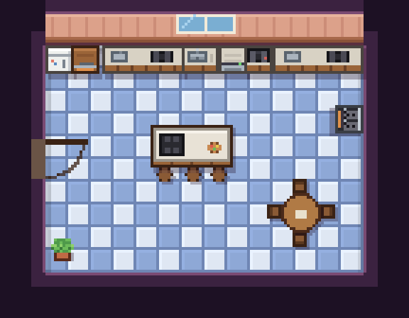 | 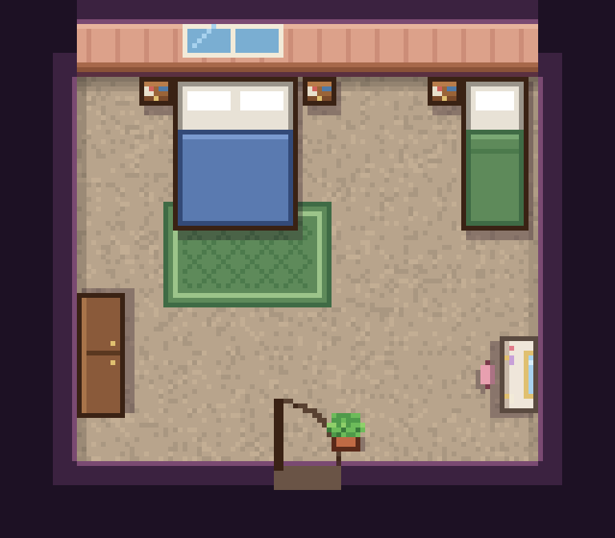 | 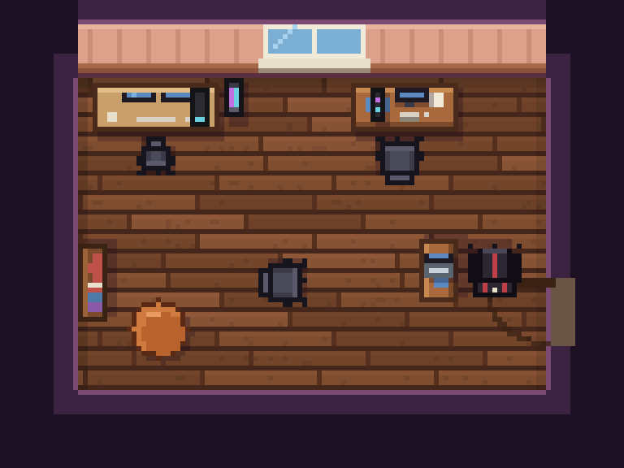 |

| Badkamer | Gang |
|---|---|
| 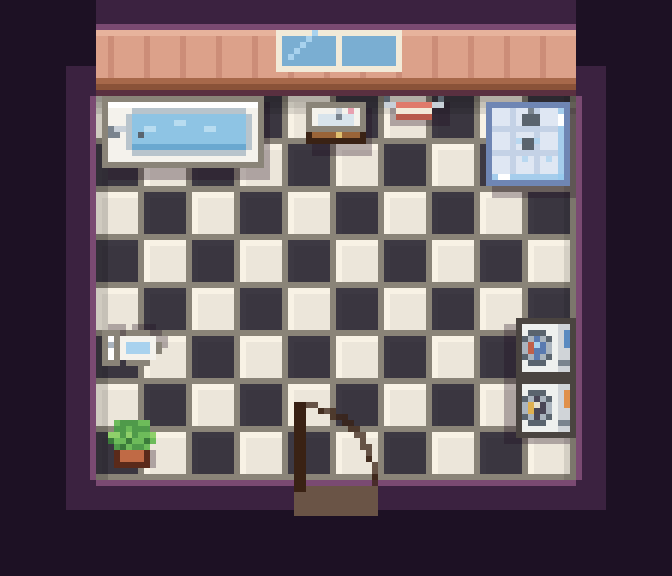 | 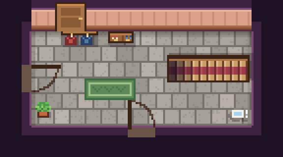 |

## Per groep

- **Woonkamer:** bank, hoekbank, fauteuil, salontafel, eettafel, boekenkast, bijzettafel, ronde tafel, open haard, piano, zitzak, poef
  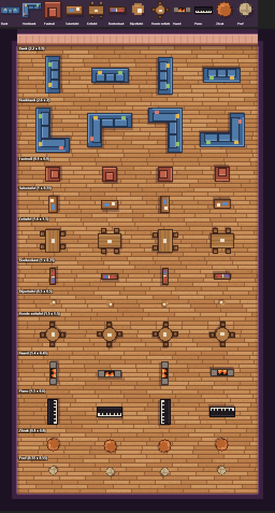
- **Keuken:** keukenblok, koelkast, fornuis, kookplaat, oven, spoelbak, vaatwasser, kookeiland
  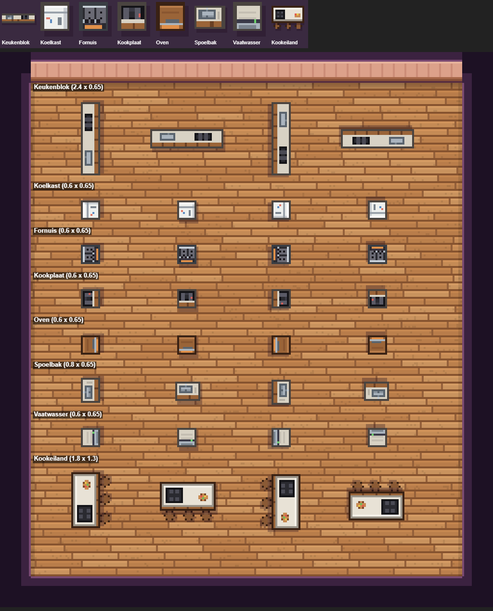
- **Slaapkamer:** bed, eenpersoonsbed, nachtkastje, kaptafel, kledingkast
  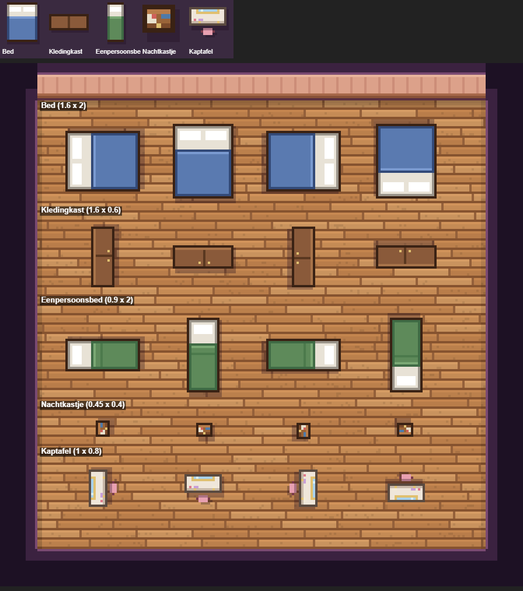
- **Werkplek:** bureau, computer, bureau met twee schermen, laptop, pc-kast, bureaustoel, gamestoel
  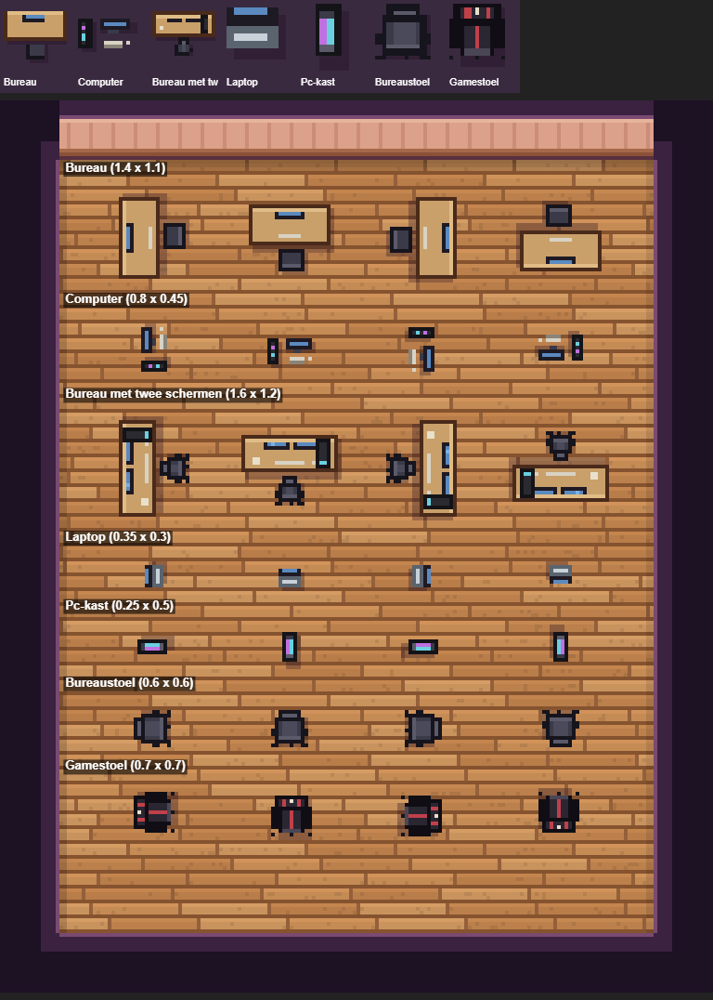
- **Badkamer:** wc, wastafel, douche, bad, wasmachine, droger, handdoekrek
  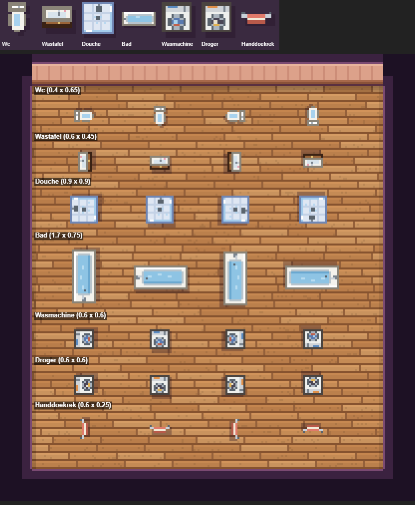
- **Gang:** kapstok, schoenenkast, trap
  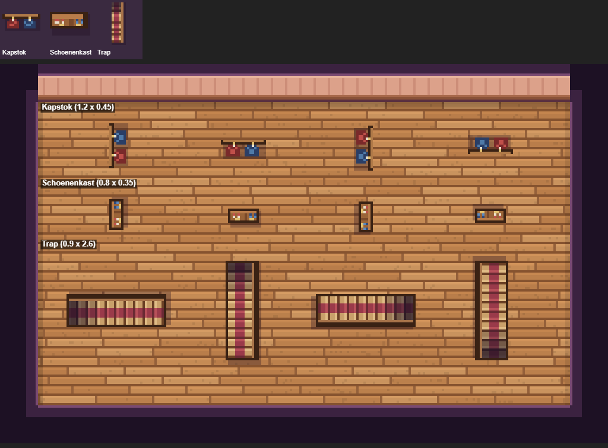
- **Overig:** plant, kleed, kast, stoel
  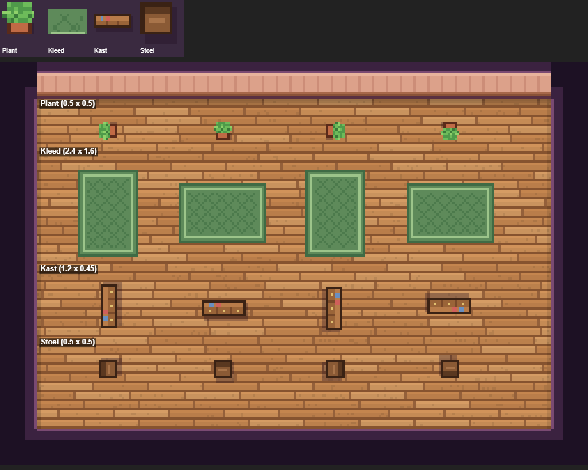
