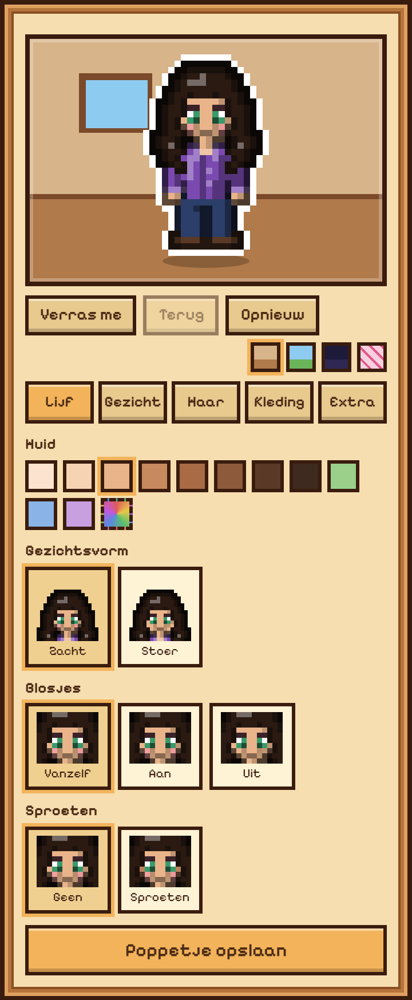
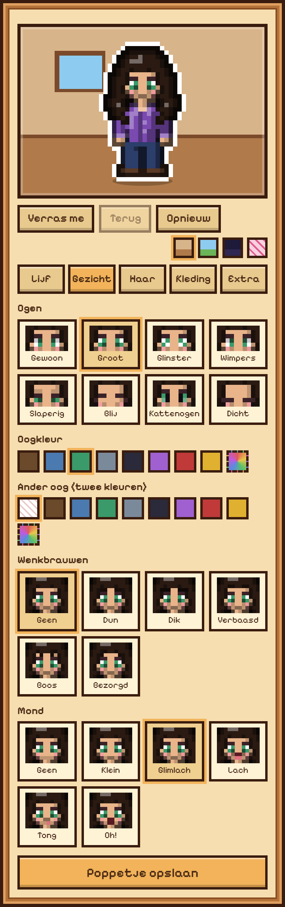
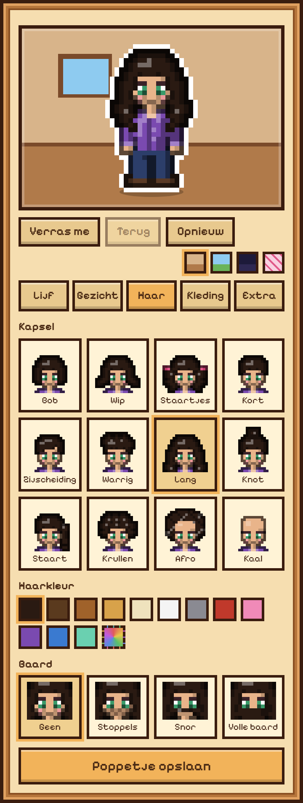
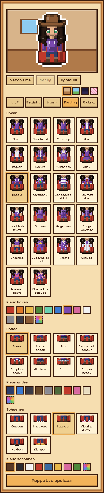
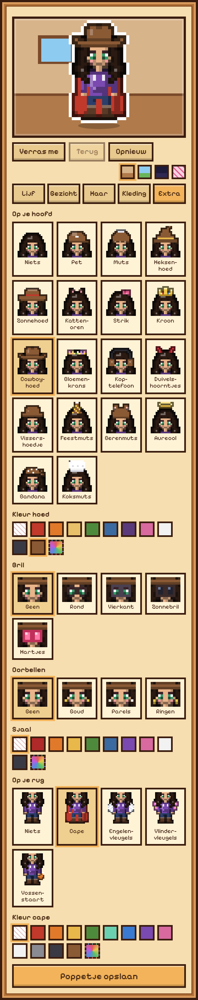
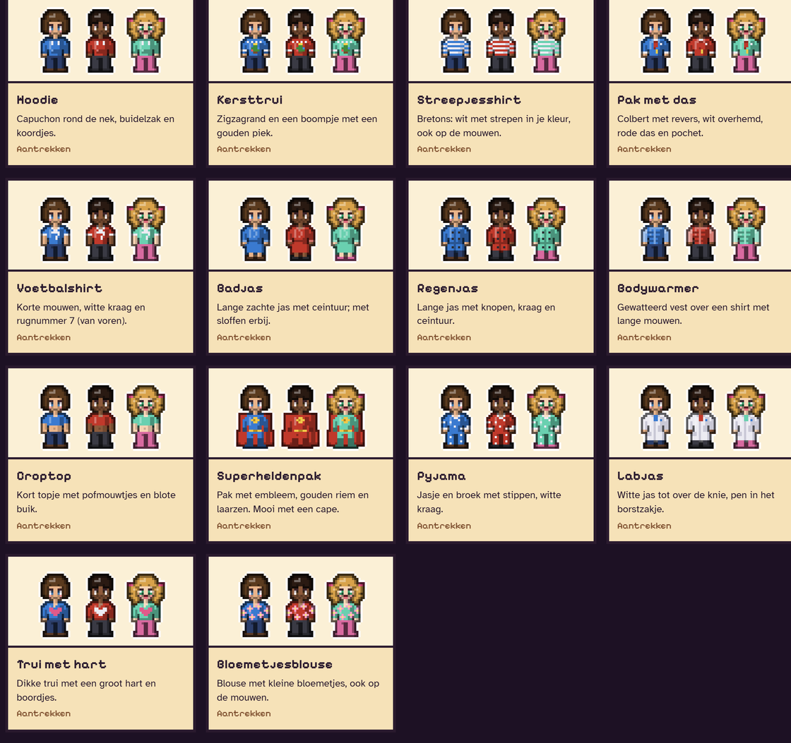
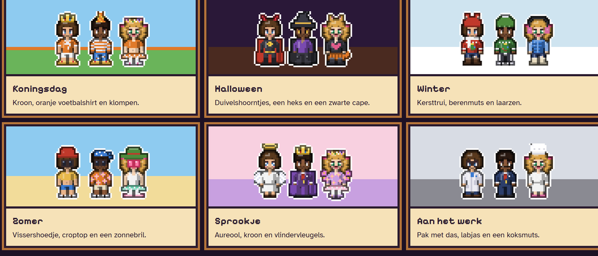

# Poppetje (House hub)

Eigen pixelpoppetjes per persoon, getekend in `drawAvatar` in `app/src/main/assets/index.html` (raster 20 x 36, Stardew-achtige maat, eigen tekening).

## Maakscherm (sinds 01-11-2026)

Instellingen, Mensen, je poppetje. Vijf tabjes met een plaatje per keuze, een groot bewegend voorbeeld (wiegt en knippert) op een achtergrond naar keuze (kamer, buiten, nacht, feest) en de knoppen Verras me, Terug en Opnieuw. Elk kleurvak heeft een eigen kleur (kleurkiezer).

| Lijf | Gezicht | Haar | Kleding | Extra |
|---|---|---|---|---|
|  |  |  |  |  |

Velden (hub bewaart ze in `People.kt`): `skin`, `face`, `blush` (auto/aan/uit), `freckles`, `eyeStyle` (gewoon, groot, ster, wimpers, slaperig, blij, kat, dicht), `eyes`, `eyes2` (ander oog), `brows`, `mouth`, `hair`, `hairColor`, `beard` (stoppels, snor, vol), `outfit`, `shirt`, `bottom`, `pants`, `shoes` (kleur), `extra` (hoed of oren/strik), `hatColor`, `glasses`, `earrings`, `scarf` (kleur of leeg).
Oude poppetjes worden bij het tekenen omgezet (`avNorm`): `extra: baard/bril/sjaal` wordt `beard: vol`, `glasses: rond` en een rode sjaal.

## Extra kleding (in de hub sinds 01-11-2026)

39 ontwerpen: 14 bovenkleding, 5 onderkant, 11 op je hoofd, 5 schoenen, 4 op je rug. Elk stuk is een tekenfunctie in `AV_X` (`tops`, `bottoms`, `hats`, `shoes`, `back`) in `index.html`; de losse ontwerpen staan ook in [`poppetje-ontwerpen.js`](poppetje-ontwerpen.js). Nieuwe velden: `shoeStyle` (Schoenen), `back` (Op je rug) en `capeColor` (Kleur cape).

